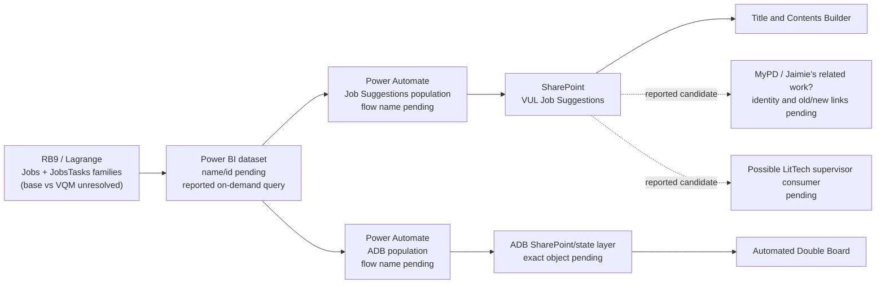
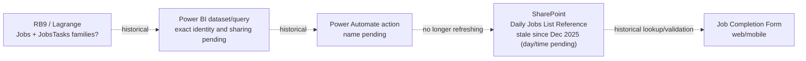

# STAR-2 — Power Platform Current-State Architecture Notes

Status: Working evidence map; not complete  
Owner: Dustin Thomason  
Started: 2026-10-20  
Last updated: 2026-10-20  
Jira: [STAR-2](https://pd-product-dev.atlassian.net/browse/STAR-2)

## Purpose

This companion artifact records the complete technical dependency paths for OJB, ADB, and TCB. A path begins at the data source and includes every view or query, gateway, connection, semantic model, Power Query step, Power Automate flow, SharePoint store, and application connection that carries the data.

The [dependency inventory](STAR-2-power-platform-dependency-inventory.md) remains the acceptance-criteria artifact. [RB9 Rules](../../rb9/rb9-rules.md) holds reusable system behavior. This document holds the wiring, environment placement, observed existence state, diagram reconciliation, and per-pipeline technical unknowns.

## Engineering boundary

- **Systems in scope:** OJB, ADB, and TCB.
- **Connected assets in scope:** anything that feeds, transforms, transports, stores, or exposes data for those systems, regardless of whether it is a Power App.
- **Shared assets:** record other consumers only when necessary to show reuse or blast radius.
- **Not part of this engineering inventory:** tenant-wide discovery of unrelated apps, stakeholder or relevance decisions, lifecycle approval, prioritization, migration implementation, or environment construction.
- **Evidence rule:** document what exists, what is reported but unverified, and what is missing or not created. Do not convert those observations into product decisions.

## Evidence boundary

| Evidence | State | What it establishes | What it does not establish |
| --- | --- | --- | --- |
| Dustin's 2026-10-20 architecture notes | Reported-current / historical as labeled below | Purposes, intended consumers, separate SharePoint lists, reported dataset/flow pattern, staleness, and known source-table scope | Exact asset ids, formulas, query text, columns, last successful run, or live connection status |
| C3 Power Platform / “RB9 Replacement Power Platform” Lucid diagram | Named evidence lead; not inspected in this session | Expected visual source for component relationships | No edge or label is treated as verified until the document/page, revision, and export are captured |
| Atlas Workflows kickoff | Reported-current shared documentation | Direct RB9 Power App access was removed; Power Automate and Power BI are the documented touchpoints | Live connection references |
| Lagrange repository | Repository-confirmed | `Jobs`, `JobsTasks`, `VQM_Jobs`, and `VQM_JobsTasks` exist in PostgreSQL-shaped Lagrange code | Which physical objects each Power BI query selects in production |
| Jaimie's Shareplane documentation | Repository-confirmed, separate scope | The exact visible SharePoint title `VUL  Job Suggestions` contains two spaces and is treated as a list distinct from OJB and OJB Archive | It does not prove the Power BI/Power Automate producer or every downstream app consumer |

No local Lucid cache/export was available during this review. Capturing the diagram is an action item, not a completed inspection.

## Reported current-state map

The diagram above shows two **reported current logical uses** of RB-derived data: the Job Suggestions/TCB path and the ADB path. Dustin reports the same Power BI dataset and methodology are used for both. Until dataset and flow definitions are exported, it is unknown whether this is one physical RB connection with two downstream uses, two queries in one dataset, or two separately refreshed paths.

### Historical / dormant Job Completion path

## Pipeline records

### 1. Job Completion Form — historical, current necessity undecided

- **Original intent:** data validation and an easier way for the signed-in user to select or obtain the correct job number.
- **User experience:** intended for browser or phone use; Active Directory identity reportedly scoped or assisted the lookup.
- **Intermediate store:** a SharePoint list referred to as **Daily Jobs List Reference**.
- **Producer:** a Power BI dataset/query followed by a Power Automate action.
- **Current condition:** the list reportedly has not updated since December 2025; the exact day/time and last successful flow run are not yet recorded.
- **Operational signal:** no user or owner reported the stale feed. Work apparently continued without it.
- **Lifecycle state:** dormant, broken, bypassed, or retired is not yet decided. “Nobody currently cares” is evidence of low observed dependency, not formal retirement.
- **Source scope lead:** only the Jobs and JobsTasks families are reported, but base tables versus `VQM_Jobs`/`VQM_JobsTasks` remains unknown.

Job Completion is outside the active OJB/ADB/TCB boundary. Retain this path only where it documents a shared technical asset or prevents two similar lists from being conflated. A product lifecycle decision is not required to complete the engineering inventory.

### 2. `VUL  Job Suggestions` — reported current shared projection

- **Exact visible title:** repository evidence shows two spaces between `VUL` and `Job Suggestions`. Capture the immutable SharePoint list id as well as the display title.
- **Producer:** reported on-demand Power BI query/dataset followed by Power Automate population.
- **Primary reported consumer:** Title and Contents Builder (TCB), where it tells users which jobs need work.
- **Additional reported consumers/leads:** Jaimie's work described as MyPD, with apparent old and new connections; possible LitTech supervisor tooling.
- **Not a current consumer:** the Job Completion Form is reported **not** to be wired to this list and was not originally intended to use it.
- **Source scope lead:** Jobs and JobsTasks only; base versus VQM objects and selected columns remain unresolved.

Jaimie's existing Shareplane documentation confirms that VUL is a real, separately queried SharePoint list, but it does not by itself prove these upstream/downstream application relationships:

- [Shareplane investigation](../../Jaimie/tickets/shareplane-modularize-availability/investigations/shareplane-modularize-availability-investigation.md)
- [Shareplane test plan](../../Jaimie/tickets/shareplane-modularize-availability/testing/shareplane-modularize-availability-test-plan.md)

### 3. Automated Double Board — reported current parallel use

- **Producer pattern:** reported to use the same Power BI dataset and Power Automate materialization method as Job Suggestions.
- **RB touchpoint:** one of the two currently known logical RB-query uses.
- **Intermediate/consumer objects:** exact flow, SharePoint/state destination, semantic-model relationship, and ADB app formula path remain unresolved.
- **Source scope lead:** Jobs and JobsTasks only; base versus VQM objects and selected columns remain unresolved.
- **Related behavior:** prior investigation separately describes a Power BI base plus SharePoint manual overrides. The materialized-list path and override path must be reconciled rather than assumed to be one thing.

## Similar SharePoint lists are not the same dependency

| Question | Daily Jobs List Reference | `VUL  Job Suggestions` |
| --- | --- | --- |
| Reported original purpose | Job Completion Form validation/job-number selection | Work suggestions / jobs requiring action |
| Confirmed/reported consumers | Job Completion Form, historically | TCB; MyPD/Jaimie and LitTech supervisor leads pending |
| Freshness | Reportedly stopped updating in Dec 2025 | Reported current; last refresh and monitoring still need proof |
| Current wiring to Job Completion Form | Historical list used by the form | Explicitly reported as not connected |
| Could it satisfy a similar lookup? | Possibly, after schema/behavior comparison | Possibly, after schema/behavior comparison |
| Is substitution current state? | No | No |

The lists may be duplicative in business content, but interchangeability is a **future design hypothesis**. Rewiring Job Completion Form to VUL would require app changes, field/grain comparison, identity filtering, freshness guarantees, and business approval. It is out of STAR-2's migration scope unless separately authorized.

## Known RB9/Lagrange source boundary

Dustin reports that only two source families are used by the Job Suggestions and ADB pattern:

| Logical family | Physical candidates | Required proof |
| --- | --- | --- |
| Jobs | `Jobs` or `VQM_Jobs` | Dataset/Power Query/native SQL; selected columns, filters, joins, keys, freshness |
| Job Tasks | `JobsTasks` or `VQM_JobsTasks` | Dataset/Power Query/native SQL; selected columns, filters, joins, keys, freshness |

“Only two tables” should be interpreted as a scope lead, not a completed inventory. If VQM views are selected, STAR-2 must also inventory their underlying tables and columns because the ticket requires the data Callisto must supply.

## Terminology collisions to keep open

| Term heard | Do not assume | Proof needed |
| --- | --- | --- |
| Job Completion Form / job submission form | These are not automatically the same asset. The shared glossary defines AJSF as Automated/Atlas Job Submission Form, and Atlas also has a separate Job Submission Form. | Power Platform app id, owner, display name, solution, and diagram node |
| MyPD / “my PDF” | The spoken reference may be MyPD, another tool, or a transcription issue. | Exact app/tool name and owner |
| `VUL  Job Suggestions` | Display name spelling and double spaces are brittle identifiers. | Immutable list id, site URL pointer, schema export |
| “same dataset” | It may mean one semantic model, one dataflow, one connection, or duplicated queries. | Workspace, dataset/semantic-model id, lineage, refresh/query mode |

## Lucid deliverables

Create one Lucid page for each in-scope system:

| Page | Required content | Status |
| --- | --- | --- |
| OJB | Complete current path from RB9/Lagrange through queries, gateways/connections, flows, SharePoint working/archive stores, and the app | Pending |
| ADB | Complete current path from RB9/Lagrange through the Power BI/Power Query layer, gateway/connections, Power Automate, SharePoint/state and override layers, and the app | Pending |
| TCB | Complete current path from RB9/Lagrange through the Power BI/Power Query layer, gateway/connections, Job Suggestions flow, `VUL  Job Suggestions`, and the app | Pending |

Use environment or platform swimlanes. At minimum, distinguish database, gateway/connection, Power BI/Power Query, Power Automate, SharePoint, and Power App layers. Label the actual Power Platform environment, workspace, site, gateway/data source, and database environment where known.

Use a visible status on every node:

- **Existing and verified**
- **Reported; verification pending**
- **Missing or not created**
- **Inaccessible**
- **Historical/shared reference**

For every node, record the asset name, type, stable id or location, environment, and evidence reference. For every edge, record direction, read/write behavior, connection/query method, trigger or refresh behavior, and the tables/columns or payload it carries. Do not place secrets or credentials in Lucid.

## Technical to-do

1. Capture the current C3/RB9 Replacement Power Platform Lucid document id, page names, revision, and export.
2. Create or reconcile the OJB, ADB, and TCB Lucid pages using the environment/status convention above.
3. Name every gateway, data source, connector, connection reference, Power BI workspace/model/query, Power Automate flow/action, SharePoint site/list, and Power App connection on those paths.
4. Record the environment and observed existence state of every named component.
5. Extract the source queries or Power Query steps proving `Jobs`/`JobsTasks` versus VQM and the exact selected columns.
6. Confirm whether ADB and TCB use one physical dataset/query/connection or separate implementations.
7. Export OJB flow definitions and identify every Jobs Notes Log category, table/column, cursor, and write target used.
8. Capture SharePoint list ids and schemas for OJB stores, ADB state/override stores, and `VUL  Job Suggestions`.
9. Export OJB, ADB, and TCB app connections/formulas needed to verify the last hop into each system.
10. Map the resulting de-duplicated RB9/Lagrange fields to Callisto, marking missing, partial, and unknown items explicitly.
